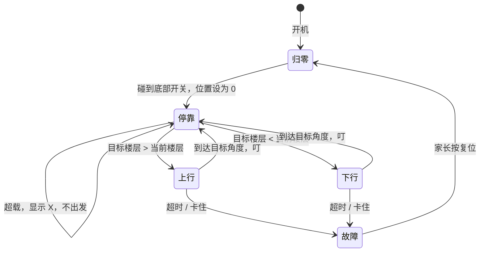

# 一一的乐高机器人 / 编程 / AI 学习：整体扩展方案

> 整理日期：2026-10-27
> 现有条件：LEGO SPIKE Essential（45345，基础套装）+ 家里的乐高 / Technic 零件 + iPad
> 第一个项目：2～3 层电梯（按钮呼叫、自动到层停车、显示楼层、超载提示）
> 参考材料：[ChatGPT 版两层电梯方案](reference/chatgpt-elevator-plan-v1.md)（下文第 1 节逐条评审）

---

## 0. 一页结论

1. **乐高机械件一直沿用，换的只是"大脑和感官"。** 不同的电子系统都能装进同一个乐高机械结构里，所以扩展的思路应该是"控制器分阶段升级"，而不是每一步都再买一整套。
2. **第 0 步不用花钱：先用 SPIKE Essential 做一个 2～3 层电梯 V0。** SPIKE 的电机自带角度传感器（编码器），可以靠"转了多少度"判断到了哪层。这是 ChatGPT 方案完全没提到的，却是最好的入门方式：零件现成，一一已经熟悉 SPIKE App。
3. **第 1 步扩展：micro:bit V2 + 一块"乐高兼容"的扩展板。** 首选 **恩孚 ELECFREAKS 哪吒Pro 扩展板（EF05070，海外叫 Nezha V2 / Nezha Pro）+ 行星X（PlanetX）传感器**：外壳带乐高孔，传感器用防反插的 RJ11 线，电机输出是十字轴。孩子能自己插线，家长不用接杜邦线。ChatGPT 推荐的 DFRobot 散件路线能用，但接线和固定到乐高上的工作基本都落在家长身上。
4. **AI 分两层：** 先在 micro:bit 上做"简单 AI"（CreateAI 动作识别，**需要电脑，不支持 iPad**），再上 **HuskyLens 2 视觉模块**，最后用 **树莓派 + Build HAT**：它能**直接接现有的 SPIKE 电机和传感器**，再加摄像头、语音和大模型。这一步正好解决"SPIKE 扩展难"的问题。
5. **ChatGPT 方案的主要问题**：只考虑 2 层（A/B 键不够 3 层用）；选了没有位置反馈的普通直流电机，所以只能靠限位开关；超载用薄膜压力片效果不好；安全部分按工业起重设备写，对乐高桌面模型过度了；扩展板的型号、名称和扩展库三者对不上。详见第 1 节。


---

## 1. 对 ChatGPT 方案的评审

### 1.1 说得对、可以保留的

| 内容 | 评价 |
|---|---|
| micro:bit V2 作为第二套控制器，用 iPad 上的 micro:bit App + MakeCode 图形化编程 | ✅ 正确。官方 iOS App 支持 MakeCode 编程和蓝牙上传。第三方扩展库在 iPad 上能不能用要实测，这个提醒也对 |
| micro:bit / 扩展板不能接 SPIKE Hub，也不能用 SPIKE App 编程 | ✅ 正确，两套系统独立 |
| 不要买"37 合 1 / 45 合 1"随机传感器套装 | ✅ 同意，接口、电平和 MakeCode 支持都不统一 |
| 5V 模拟信号不能直接接 micro:bit 引脚（micro:bit 是 3.3V） | ✅ 正确，很重要 |
| 用"状态机"组织电梯逻辑；软件消抖；超载阈值要有滞回；运行超时就报故障 | ✅ 思路很好，第 3 节沿用 |
| 分阶段学习，每次只加一个模块并单独测试 | ✅ 同意 |

### 1.2 有问题或不清楚的地方

| # | ChatGPT 的说法 | 问题 | 建议 |
|---|---|---|---|
| 1 | 只做 2 层，用 micro:bit 的 A/B 键呼叫 | 你要的是 2～3 层。A/B 只有两个键，做 3 层就不够；楼层越多，限位开关和接线也越多 | 楼层按钮外接（3 个以上）；楼层定位用编码器，不按楼层加开关 |
| 2 | "依靠限位开关，不依赖定时猜位置" | 这是个假二选一。还有第三种、也是真电梯用的方法：**电机编码器计数 + 底部一个归零开关**。SPIKE 电机本来就有编码器 | 阶段 0 用 SPIKE 编码器；阶段 1 选带位置反馈的电机 |
| 3 | 电机选 KittenBot GeekServo 2KG 红色两线直流电机 | 没有位置反馈，只能"开 / 关"。另外文档自己也承认没查清扩展板单路电流是否够用，等于主方案的关键一环没验证 | 换成带角度反馈的乐高兼容智能电机（如恩孚行星X 智能积木电机 EF05071，带编码器，重复定位 ≤3°），电机和驱动板是同一家的配套产品，就不用自己核对电流 |
| 4 | 扩展板写的是"DFRobot MBT0014 掌控 IO 扩展板"，扩展库写的是 `pxt-micro-IOBOX` | **型号、名称、扩展库三者对不上**："掌控"在 DFRobot 的命名里通常指掌控板（mPython），而 `pxt-micro-IOBOX` 对应的是 micro:IOBOX 驱动板。我查不到 MBT0014 的明确产品页 | 不要按这个型号直接下单。走 DFRobot 路线的话，可参考有明确规格的 **DFR0548 micro:Driver**（HR8833 驱动，持续 1.5A，4 路电机 + 8 路舵机） |
| 5 | 超载用薄膜压力片（SEN0616） | 薄膜压力片（FSR）是非线性的，压久了读数会漂，受力点稍偏读数就变，阈值很难调稳。孩子很容易得出"传感器坏了"的结论 | 入门：**弹簧底板 + 一个按键开关**（超重就压下去，二值、直观）。进阶：**称重传感器 + HX711**（能显示克数，还能学"校准"）。零件方案：用"上楼时间变长"判断超重 |
| 6 | 大量"防下坠 / 安全回路 / 非认证起重设备"的警告 | 对一个几十到一两百克的乐高轿厢来说过度了，读起来会让人觉得很危险、很难。乐高**蜗杆传动本身就能自锁**，是乐高电梯的标准做法 | 保留真正有用的几条：低压供电、手指远离齿轮、加机械止挡。其他略过 |
| 7 | 用散装微动开关、杜邦线 / 3P 线自己接，"不可根据线材颜色假设线序" | 这本身就说明了接线容易出错。微动开关要固定到乐高上也不方便（得用胶或扎带） | 优先选外壳带乐高孔、防反插接口的传感器系统（第 2 节） |
| 8 | "AI 摄像头和语音识别第一版不需要"，整份方案没有 AI 路线 | 你的目标里有 AI，应该提前规划 | 第 2.4 节给出 AI 路线 |
| 9 | 价格精确到 ¥135、¥89 等，并列了很多淘宝 / 京东链接 | 价格和链接会变；部分型号本身就有问题（见第 4 条） | 以型号为准，到官方店或旗舰店搜索 |

---

## 2. 推荐的整体扩展路线

### 阶段 0：只用 SPIKE Essential 做电梯 V0（0 元，1～2 个周末）

SPIKE Essential 的限制是 Hub 只有 **2 个端口**，所以这一版要"一个端口接电机，另一个端口二选一"。

**机械（推荐结构）**

- 井道：Technic 梁搭两根立柱，轿厢两侧用梁 / 销夹住立柱做导轨，防止晃动。
- 驱动：电机 → **蜗杆（1:24 减速）** → 卷扬卷筒（绳子吊轿厢），或者 → 齿轮 → 竖直齿条。
  - 蜗杆有三个好处：力气大、速度慢（更容易停准）、**断电后轿厢不会掉下来（自锁）**。
- 层高 10～12 cm，先做 2 层，跑稳后加到 3 层。
- 顶部和底部各加一根梁做机械止挡。

**电子分配（两种方案选一个）**

| 方案 | 端口 A | 端口 B | 呼叫方式 | 楼层显示 |
|---|---|---|---|---|
| V0-a（推荐） | 电机（升降） | 颜色传感器 | 把红 / 黄 / 蓝积木放到传感器前 → 去 1 / 2 / 3 楼 | Hub 指示灯颜色 + iPad 播放"叮，2 楼到了" |
| V0-b | 电机（升降） | 3×3 光阵 | 程序里预设"巡游"：1→2→3→2→1，每层停 3 秒 | 光阵亮 1 / 2 / 3 行表示楼层 |

**核心原理（一一要学会的第一个"机器人概念"）：用角度当尺子**

1. 开机前把轿厢放到 1 楼，程序第一句：**把电机位置设为 0**（这就是"归零 / 校准"）。
2. 手动让电机上行，记下到 2 楼时的角度，比如 720°，到 3 楼时 1440°。
3. 呼叫 2 楼 = "让电机转到 720°"。不用开关，也不用计时。
4. 超载实验（不需要传感器）：记下空载从 1 楼到 2 楼用了几秒；装上重物再测。时间明显变长（或者电机转不动）就显示"超载"。这能让孩子理解"机器可以通过自己的表现感知外界"。

> 这一阶段学到的东西：顺序执行、条件判断、变量（目标楼层 / 当前楼层）、校准、"状态"。这些概念换到 micro:bit 上全部通用。

### 阶段 1：micro:bit V2 + 乐高兼容扩展板，做"3 层完整电梯"

**为什么选 micro:bit**：便宜、有 5×5 屏和两个按钮、能用 iPad 编程（MakeCode 图形化，以后还能切到 JavaScript / Python）、可以无线组网，还有 AI 入门工具（CreateAI）。国内买得到，资料也多。

**扩展板 / 传感器生态对比**

| 方案 | 乐高兼容 | 接线难度 | 电机 | 适合谁 |
|---|---|---|---|---|
| **恩孚 ELECFREAKS 哪吒Pro（EF05070）+ 行星X PlanetX 传感器（首选）** | 扩展板外壳和传感器都带乐高 / 慧鱼孔，电机是十字轴输出 | **低**：RJ11 防反插，孩子能自己插 | 4 路电机口，配套行星X 智能积木电机（EF05071，带编码器，可读角度、转到指定角度，重复定位 ≤3°）；内置 900mAh 锂电池 | 想让孩子自己动手、少踩接线坑 |
| ELECFREAKS 悟空 Wukong | 积木兼容外形 | 中 | 2 路电机 + 舵机 | 预算更紧、项目更小 |
| DFRobot micro:Driver（DFR0548）+ Gravity 传感器 | 板子不带乐高孔，要靠转接件 / 扎带 / 3D 打印固定 | 中～高：3P 线，要自己核对线序和电压 | 4 路直流电机（HR8833，1.5A）+ 8 路舵机，电机得自己选 | 家长喜欢动手、想要更多种传感器 |

> 建议先买 **哪吒Pro 主板（或含主板的套件）+ 需要的几个 PlanetX 传感器**。买套件还是单买，取决于家里乐高零件够不够。

**阶段 1 的电梯 V1 配置**

| 功能 | 模块 | 说明 |
|---|---|---|
| 升降 | 哪吒智能电机 ×1（+ 蜗杆减速） | 角度定位，延续阶段 0 的方法 |
| 归零 | 底部一个按钮 / 碰撞开关 | 开机时自动慢速下行，碰到开关就把位置设为 0（真电梯也这样做） |
| 楼层呼叫 | PlanetX 按钮 ×2～3 个（或一个双键模块） | 1F / 2F / 3F；micro:bit 的 A / B 键留作"开门 / 急停" |
| 楼层显示 | micro:bit 5×5 屏 → 进阶换**数码管**或 **OLED** | 数码管最像真电梯；OLED 可以显示"2F ↑" |
| 到站提示 | 蜂鸣器（部分扩展板自带） | "叮" |
| 超载 | 弹簧底板 + 按键（入门）/ 称重传感器 + HX711（进阶） | 见第 3.4 节 |

### 阶段 2：传感器扩展（每个都能在别的项目里复用）

| 传感器 | 在电梯里的用途 | 还能做什么 | 学到的概念 |
|---|---|---|---|
| 按钮 / 碰撞开关 | 呼叫、归零、急停 | 闸机、抢答器、游戏手柄 | 数字输入、消抖 |
| 霍尔 / 磁感应 + 小磁铁 | 非接触式楼层标记、门关好检测 | 自行车码表、转速计 | 非接触检测 |
| 红外避障 / 对射 | 电梯门防夹 | 自动门、计数器、闸机 | 光电检测 |
| 超声波测距 | 测轿厢高度（检验编码器准不准） | 倒车雷达、避障小车 | 测距、误差 |
| 光线传感器 | 有人进轿厢时自动亮灯 | 自动路灯、追光车 | 模拟量、阈值 |
| 舵机 | 开关电梯门 | 机械臂、闸机杆 | 角度控制 |
| 称重传感器 + HX711 | 显示载重克数、超载 | 电子秤、自动喂食器 | 校准、线性关系 |
| 数码管 / OLED | 楼层和方向显示 | 计时器、温度计 | 输出、显示编码 |
| 颜色 / 巡线传感器 | 用色块标记楼层 | 巡线小车、分拣机 | 分类 |
| 第二块 micro:bit（无线） | **每层一个呼梯面板**，无线发给主控 | 遥控车、对讲、投票器 | 通信、分布式系统 |

> 推荐顺序：按钮 → 显示（数码管 / OLED）→ 舵机门 + 红外防夹 → 称重 → 第二块 micro:bit 无线呼梯。
> 每加一个传感器，就给电梯加一个"真电梯有的功能"，孩子会很有成就感。

### 阶段 3：AI 路线

| 层级 | 工具 | 电梯项目怎么用 | 注意 |
|---|---|---|---|
| AI 入门 | **micro:bit CreateAI**（免费，训练动作识别模型，模型跑在 micro:bit V2 上） | 戴着 micro:bit 挥手 = 呼叫电梯；拍两下 = 去 3 楼 | 官方说明**目前不支持 iPad**，需要电脑上的 Chrome / Edge |
| 视觉 AI | **DFRobot HuskyLens 2**（人脸 / 物体 / 标签识别，I2C/UART 接 micro:bit，支持 MakeCode / Mind+） | 认出一一 → 自动去一一常去的那层；识别贴在每层的标签来校正位置 | 需要单独 USB-C 供电；和 SPIKE 的连接没有官方方案 |
| 真正的 AI 编程 | **树莓派 + Raspberry Pi Build HAT** | Build HAT 有 4 个 SPIKE 接口，**直接复用现有 SPIKE 电机和传感器**；加摄像头、麦克风，用 Python 做"语音说'去二楼'" → 本地模型或大模型理解 → 电梯执行 | 需要 8V 外接电源；Essential 小电机和 3×3 光阵的支持要实测（社区库有 3×3 光阵示例）；适合孩子能打字、开始学 Python 以后 |
| 进阶桥接（可选） | LMS-ESP32（插在 SPIKE 端口上，"冒充"乐高传感器，后面能接任意传感器） | 给 SPIKE Hub 增加任意传感器 | 要用 Pybricks / Python；Essential 本来就只有 2 个端口，用处有限，更适合以后升级 SPIKE Prime |

> 关于 SPIKE Prime：如果以后决定继续走乐高官方路线，Prime（6 个端口、力传感器、距离传感器）是官方的扩展方向，力传感器正好能当按钮或做超载检测。但它比 micro:bit 路线贵得多，传感器种类也少，**不建议作为下一步**。

---

## 3. 电梯具体怎么实现（适用于阶段 0 和阶段 1）

### 3.1 楼层定位：四种方法对比

| 方法 | 原理 | 优点 | 缺点 | 建议 |
|---|---|---|---|---|
| 定时 | 转 3 秒 ≈ 一层 | 最简单 | 电量、负载一变就不准 | 只做第一节课的对比实验 |
| 每层一个限位开关 | 碰到开关就停 | 直观 | 楼层越多开关越多，安装麻烦，越位后就"迷路" | 不推荐做主方案 |
| **编码器 + 归零** | 开机先找到底部 = 0°，之后按角度去每层 | 精确、可扩展到任意层数、和真电梯原理一样 | 要先校准每层角度 | **推荐** |
| 色块 / 磁铁标记 | 轿厢上的传感器识别每层的标记 | 能"纠错"，绳子打滑也不怕 | 多一个传感器 | 阶段 2 叠加在编码器上做校正 |

### 3.2 状态机（让一一先用中文画在纸上）



### 3.3 程序逻辑（MakeCode 积木思路，伪代码）

```text
变量：楼层角度 = [0, 720, 1440]   ← 自己实测后填写
变量：当前楼层 = 1，目标楼层 = 1

开机时：
    电机慢速向下，直到"底部开关"被按下
    电机位置清零；当前楼层 = 1；显示 1

当 按钮1 / 按钮2 / 按钮3 被按下：
    如果 超载 → 显示 X，响一声，结束
    目标楼层 = 按下的那个楼层

无限循环：
    如果 目标楼层 ≠ 当前楼层：
        显示 ↑ 或 ↓
        电机转到 楼层角度[目标楼层]（同时开始计时）
        如果 超过 N 秒还没到 → 停电机，显示 E（故障）
        否则：当前楼层 = 目标楼层；显示楼层号；叮
```

**进阶算法题（适合上小学中高年级以后）**：多人同时按不同楼层，先去哪层？真电梯用的是"同方向顺路优先"（电梯算法 / SCAN）。可以让一一先当"人肉电梯"，在纸上模拟，再写成程序。

### 3.4 超载检测：三种做法

| 做法 | 零件 | 难度 | 孩子能学到 |
|---|---|---|---|
| A. 时间法（阶段 0 就能做） | 无，只用电机 + 计时器 | ★ | 用"表现"推断"原因" |
| B. 弹簧底板 + 按键 | 轿厢底板下放橡皮筋或弹簧，重了就压下按键 | ★★ | 机械和电子配合、阈值 = 弹簧的松紧 |
| C. 称重传感器 + HX711 | 小量程称重梁（如 1kg）+ HX711 放大板 | ★★★ | 校准（去皮、放已知重量）、显示克数、阈值和滞回 |

> 不推荐薄膜压力片做超载：读数漂移、受力点敏感，调不稳。

---

## 4. 采购建议（按阶段，买前以官方店型号为准）

| 阶段 | 买什么 | 备注 |
|---|---|---|
| 0 | **不用买** | 可能要补几根长梁、蜗杆、绳子 |
| 1 | micro:bit V2（认准 **V2**）+ 哪吒Pro 扩展板 + 智能积木电机 + 行星X 按键 / 碰撞 / 数码管 | 完整清单见 [第一阶段购买清单](phase1-shopping-list.md) |
| 1（可选） | PlanetX 数码管或 OLED | 楼层显示更像真电梯 |
| 2 | 舵机（开门）、红外避障、称重传感器 + HX711、第二块 micro:bit | 一次加一个 |
| 3 | HuskyLens 2；之后再考虑树莓派 5 + Build HAT + 8V 电源 + 摄像头 | 树莓派这一步要配电脑或显示器、键盘 |

**买前要核实的清单**

- [x] 哪吒Pro + 智能积木电机能在 MakeCode 里读取角度、转到绝对位置（官方扩展 `nezha2` 有 goToAbsolutePosition 等积木）
- [ ] 哪吒Pro / PlanetX 的 MakeCode 扩展能否在 **iPad 的 micro:bit App** 里加载、编译、蓝牙上传（收到货第一天就测；不行就先用电脑）
- [x] 扩展板供电：内置 900mAh 锂电池，Type-C 充电（5V），不用另买电池
- [ ] HX711 在 MakeCode 里有可用的扩展（社区扩展较多，买之前搜一下）

---

## 5. 小结：为什么这样排

- **先用已有的 SPIKE 把"电梯思维"建立起来**（定位、校准、状态、反馈）。这些概念以后换到任何平台都用得上，花费为零。
- **再用 micro:bit 生态解决"传感器少"的问题**，优先选乐高兼容、防插错的系统，让孩子自己动手，家长不用当接线员。
- **AI 不是另一个项目，而是给同一个电梯加"眼睛和耳朵"**：动作识别呼梯 → 看脸选楼层 → 听懂一句话。最后用树莓派 + Build HAT 把最早的 SPIKE 零件也接回来，形成闭环。

---

## 资料来源

- [ELECFREAKS 哪吒扩展板与智能电机发布说明](https://shop.elecfreaks.com/blogs/news/new-product-launch-nezha-expansion-intelligent-motor)
- [ELECFREAKS Nezha V2 扩展板产品页](https://shop.elecfreaks.com/es/products/nezha-breakout-board-v2)
- [ELECFREAKS PlanetX 光线传感器（"Compatible to bricks"）](https://shop.elecfreaks.com/products/elecfreaks-planetx-light-sensor)
- [DFRobot DFR0548 micro:Driver 规格](https://core-electronics.com.au/micro-bit-driver-expansion-board.html.plain.md)
- [DFRobot pxt-micro-IOBOX（对应 micro:IOBOX 驱动板）](https://github.com/DFRobot/pxt-micro-IOBOX)
- [micro:bit CreateAI 用户指南](https://microbit.org/get-started/user-guide/microbit-createai/) / [micro:bit AI 功能（中文）](https://microbit.org/zh-cn/get-started/features/ai)
- [HuskyLens 2 与 micro:bit 使用说明（DFRobot Wiki）](https://wiki.dfrobot.com/sen0638/docs/24853)
- [Raspberry Pi Build HAT（PyPI）](https://pypi.org/project/buildhat/) / [Build HAT 介绍](https://www.cnx-software.com/2021/10/19/lego-technic-meets-raspberry-pi-with-the-build-hat/) / [CircuitPython BuildHAT 库（含 3×3 光阵示例）](https://circuitpython-raspberrypi-buildhat.readthedocs.io/en/latest/search.html)
- [Pybricks：SPIKE Essential 只有两个端口的说明](https://pybricks.com/learn/building-a-robot/spike-essential/)
- [Anton's Mindstorms（LMS-ESP32）文档](https://www.antonsmindstorms.com/docs/)
