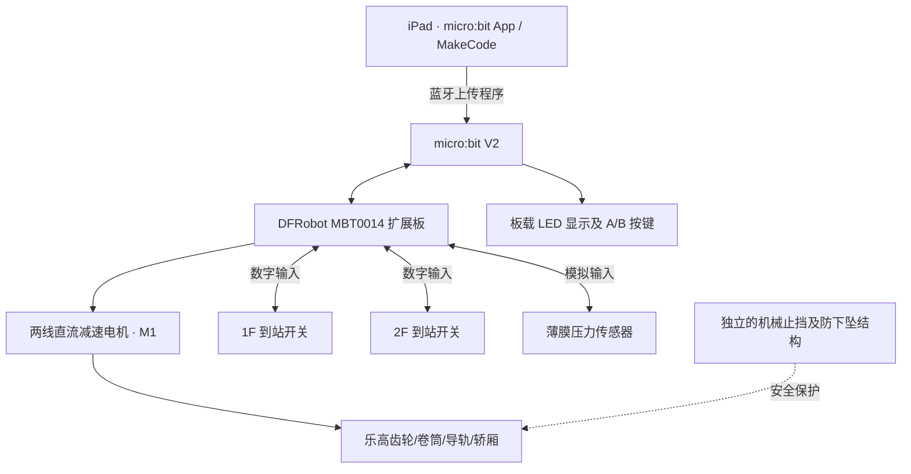

# 乐高两层智能电梯：设计方案、采购清单与扩展路线

> **版本**：V1.0  
> **整理日期**：2026-10-27  
> **适用条件**：已有 LEGO SPIKE Essential 45345 及 Technic 机械件；准备从 iPad 开始学习图形化编程；不要求加减速；需要两层按钮控制、自动停靠、楼层显示与超载检测。  
> **方案边界**：这是桌面教学模型，不是可载人的电梯，也不是具备认证安全保护的起重设备。

## 0. 一页结论

**推荐主方案：micro:bit V2 + DFRobot MBT0014 电机扩展板 + 乐高兼容两线减速电机 + 两个到站检测开关 + 一片薄膜压力传感器。**

- **iPad 编程**：micro:bit 官方 iOS App → MakeCode 中文图形化积木 → 蓝牙上传至 micro:bit。
- **机械部分**：沿用现有乐高梁、齿轮、轴、卷筒和轿厢结构；无需再买一整套机器人。
- **第一版功能**：A 键去 1 楼，B 键去 2 楼；到站自动停机；LED 显示 `1`、`2` 或故障标识；检测到压力阈值超限则禁止启动。
- **最重要的采购前确认**：**MBT0014 的单路电机驱动电流额定值**必须覆盖所选电机的正常、启动及异常负载电流。已查到电机堵转数据，但暂未获得足够明确的扩展板单路连续/峰值电流规格，不建议在核对前把“电机+扩展板”视作已验证匹配。
- **最重要的机械要求**：即使控制器断电或电机停转，轿厢也不能自由坠落；需采用低质量、短行程、导向、止挡和经测试的防下坠/配重结构。

**建议采购次序**：① micro:bit + 扩展板 + 限位开关；② 核实电流后购买电机及电源；③ 压力传感器；④ 其他扩展传感器。

---

## 1. 目标与验收条件

| 项目 | V1.0 目标 | 验收方式 |
|---|---|---|
| 两层 | 仅 1F / 2F，建议层间约 15–20 cm | 轿厢上下运动正常 |
| 楼层指令 | A 键召唤 1F、B 键召唤 2F | 从任一层按目标键均可响应 |
| 自动停靠 | 依靠楼层限位开关，不依赖定时猜位置 | 反复测试不越位 |
| 楼层显示 | micro:bit 5×5 LED 显示 `1`、`2` | 与实际位置一致 |
| 超载 | 薄膜压力传感器检测受压变化；超过经试验设定的阈值禁止发车 | 增加/移走试验砝码，状态正确变化 |
| 故障处理 | 开关矛盾、运行超时、开关/线缆故障时进入故障态 | 停止驱动并提示，人工排查后复位 |
| 编程方式 | iPad 上 MakeCode 积木式编程 | 程序成功通过蓝牙上传 |
| 暂不实现 | 加减速、自动开关门、准确称重克数、联网、语音 | 不作为验收条件 |

> **超载阈值不是设备额定载重**。可以用砝码/积木做压力阈值实验，但阈值需要结合压力片的位置和结构实际校准。薄膜压力片更适合做“压力变大/超过阈值”的教学演示，不等于精密电子秤。

## 2. 推荐的总体架构



**与现有 SPIKE 的关系**：乐高机械零件可以共用；micro:bit/MBT0014 不是 SPIKE Hub 配件，不能直接连接或通过 LEGO SPIKE App 编程。建议把 SPIKE 45345 留作另一套独立控制系统。

### 2.1 机械布局建议

1. 用 Technic 梁搭一个刚性的两层井架，轿厢两侧做导轨，减少摆动。
2. 在上部布置电机、齿轮组及卷筒/齿条机构；电机输出端采用乐高十字轴兼容连接。
3. 在 1F、2F 分别固定一个到站微动开关，采用可调位置安装，逐次调节停靠位置。
4. 压力传感器放在轿厢内部**受控受力位置**，例如轿厢底板下方的弹性平台中；必须保证实验载荷确实经过压力片。
5. 加机械上、下止挡及防下坠机构；电机失去供电时需测试轿厢是否保持安全。普通减速电机通常**不保证自锁**，乐高蜗杆也不能未经测试就当作唯一安全保障。
6. 第一次测试只用很轻的空轿厢；确认受力和紧急断电响应，再逐步加少量试验载荷。

**不建议**把轿厢直接挂在一根绳上、仅靠电机通电保持位置；也不要让儿童将手放在齿轮、滑轮、导轨与轿厢的夹点之间。

## 3. 采购清单：V1.0 必需品

以下优先采用**厂商有型号和技术文档的产品**。标价来自公开页面或估算，实际下单前仍须核对 SKU、价格、运费、库存。所列淘宝/京东链接不代表能核实结算页实时库存。

| 优先级 | 名称（型号） | 数量 | 价格参考 | 采购 / 规格链接 | 备注 |
|---|---|---:|---:|---|---|
| 必买 | BBC micro:bit V2 主板（DFRobot SKU MBT0039） | 1 | **¥135** 厂商标价 | [DFRobot 中国商城](https://www.dfrobot.com.cn/goods-2921.html) | 自带 A/B 两按钮、5×5 LED、蓝牙；勿误买 V1 或纯扩展配件 |
| 必买 | DFRobot micro:bit 掌控 IO 扩展板 **MBT0014** | 1 | **¥89** 厂商标价 | [厂商商城](https://linpro.dfrobot.com.cn/goods-1966.html) / [官方技术说明](https://wiki.dfrobot.com.cn/_SKU_MBT0014_%E6%8E%8C%E6%8E%A7IO%E6%89%A9%E5%B1%95%E6%9D%BF) | 两路电机接口、10 路数字/模拟接口；供电 3.5–5V，外接供电驱动电机 |
| **待电流验证** | KittenBot **GeekServo 2KG 红色两线减速电机** | 1 | **¥25–60** 估算 | [KittenBot 规格文档](https://kittenbot.readthedocs.io/electronics/2KG.html) / [厂商文档所列淘宝链接](https://item.taobao.com/item.htm?id=603423647052) | 3.3–6V，4.8V 额定；额定电流约 200mA、堵转约 700mA；**买红色两线直流电机，别误买灰色三线舵机** |
| 必买 | 三脚微动限位开关（COM/NO/NC） | 2 个，建议另备 1–2 个 | **¥6–15** 估算 | [京东 KW11 相关商品入口（下单前核对）](https://item.jd.com/10184302594168.html) | 1F 和 2F 到站检测；首选有 NC 常闭触点型号 |
| 必买 | DFRobot **SEN0616** 薄膜压力传感器 | 1 | **¥32** 厂商标价 | [DFRobot 中国商城](https://www.dfrobot.com.cn/goods-4015.html) | 3.3–5V、模拟输出，带 3P 线；用于相对压力/超载阈值 |
| 必买 | 5V 稳定电源及 Micro-USB 供电线 | 1 套 | **¥15–30** 估算 | 按 MBT0014 电机驱动要求购买 | 电机由扩展板外接电源供电，不能只依赖 micro:bit 主板 USB；需核对实际峰值电流 |
| 必买 | 3Pin 传感器连接线、导线与绝缘/固定材料 | 1 套 | **¥15–30** 估算 | 首先核对 MBT0014 插针排列与 SEN0616/开关线序 | 不可根据线材颜色直接假设信号和电源顺序 |
| 按需 | 电机固定件、十字轴、齿轮、滑轮/卷筒、配重与止挡 | 按设计 | **¥10–30** 新增估算 | 现有乐高 Technic 零件优先 | 技术上必须先验证防坠机构 |

**第一版估算合计：¥327–421**（按上述估算范围计算，**不含新增乐高大件、已拥有的工具、运费**；价格不是实时成交价）。若先用 micro:bit 自带按钮和屏幕，不需外购按钮与显示屏。

### 3.1 推荐替代与比选

| 选择 | 什么时候更合适 | 优点 | 限制 |
|---|---|---|---|
| **MBT0014（首选）** | 单电机 + 多个普通传感器 | ¥89；接口够用；有官方 MakeCode 电机扩展 | 要核对电机连续/峰值电流与连接端子；外接供电 |
| [DFRobot MBT0044 建筑积木扩展板](https://www.dfrobot.com.cn/goods-4256.html) | 后续需要更多电机和整齐的积木化装配 | 厂商标价 ¥149；4 路电机接口，乐高积木底座 | 供电/电池要求不同；具体电机接口和 iPad 软件步骤需单独验证 |
| [ELECFREAKS Wukong 悟空扩展板](https://shop.elecfreaks.com/products/elecfreaks-micro-bit-wukong-expansion-board-adapter) | 希望更轻便，已有/能买到相应配件 | 积木结构友好、有电机及舵机接口 | 国内独立零售渠道及现货尚未核实；不要为它专门增加太多采购难度 |
| 高扭矩其他减速电机 + 独立驱动器 | 轿厢负载超过 GeekServo 能力 | 电机选择多 | 电压、驱动电流与机械连接的复杂度提高，不建议第一阶段购买 |

### 3.2 电机购买前需要问卖家的四个问题

1. **是否红色两线直流减速电机**？能否正反连续转动（不是灰色伺服舵机）？
2. 输出端是否是 **LEGO Technic 十字轴孔**？是否配电机安装销？
3. 电机**额定电流、启动电流、堵转电流**是多少？（厂商文档对红色 2KG 型号给出额定约 200mA、堵转约 700mA，仍应核对实际销售版本。）
4. **MBT0014 单路驱动的连续/峰值电流**及过流保护是多少？如果卖家无法明确确认，就不要带负载试转或直接把它作为电梯正式驱动方案。

## 4. 接线与接口规划（待购买实物核对）

以下是**引脚分配建议**，不是已经通过实物测试的最终接线图。电机驱动用 MBT0014 官方 MakeCode 扩展接口，不直接占用普通 GPIO。

| 模块 | 计划端口 | 信号类型 | 说明 |
|---|---|---|---|
| 电机 | MBT0014 M1 | 电机驱动 | 两线直流减速电机；正反转按实测设定 |
| 1F 到站开关 | P8 | 数字 | NC 常闭触点 + GND + 软件上拉，触发前后的电平逻辑需实测 |
| 2F 到站开关 | P9 | 数字 | 同上 |
| SEN0616 压力传感器 | P1 | 模拟 | 建议 3.3V 供电、GND、模拟信号；禁止 5V 模拟信号直入 micro:bit GPIO |
| 楼层呼叫 | micro:bit A/B | 板载按钮 | A→1F，B→2F |
| 楼层与报警显示 | 5×5 LED | 板载显示 | `1` / `2` / `X` / `E` |
| 蜂鸣器（可选） | MBT0014 板载 | P0 | 官方文档注明 P0 占用；若要使用 P0 外接传感器则关闭蜂鸣器开关 |
| 未来门磁 | P12 或 P13 | 数字 | 先确认未被其他扩展占用 |
| 未来光敏 | P2 / P14 等 | 模拟 | 重新核查引脚能力及其他功能冲突 |
| 未来 I²C OLED | I²C 端口 | I²C | 需核对显示屏 3.3V 逻辑和具体地址 |

> **重要**：微动开关的 NC 接法有利于检测断线，但单靠软件上拉不能覆盖所有故障形式。这里是教学层面的检测，不构成符合任何电梯标准的安全回路。
>
> **线缆注意**：DFRobot Gravity 模块通常自带连接线，但不同版次的 3P 排列可能不同。逐一依据传感器的 `S/V/GND` 和 MBT0014 对应口的标记确认，先断电接线，再单模块通电测试。

## 5. 控制逻辑：让一一能参与设计的状态机

建议一一先用中文设计逻辑，再在 MakeCode 中拖拽按钮、变量、条件判断和循环积木。

### 5.1 电梯状态

- `IDLE_1`：停在 1F；显示 `1`；允许接收 2F 指令。
- `IDLE_2`：停在 2F；显示 `2`；允许接收 1F 指令。
- `UP`：正在向 2F 运行。
- `DOWN`：正在向 1F 运行。
- `OVERLOAD`：载荷压力超阈值；**停层时禁止开始新运动**，显示 `X`。
- `FAULT`：楼层开关信号异常、超过运行时间、供电/执行异常；立即禁止继续驱动、显示 `E`，由家长检查并复位。

### 5.2 逻辑示意

```text
开机：
    停止电机
    读取 1F / 2F 限位开关
    如果仅 1F 开关触发 → 状态 = IDLE_1
    否则如果仅 2F 开关触发 → 状态 = IDLE_2
    否则 → FAULT（第一次由家长手动定位、校准，不盲目自动找零）

主循环：
    连续读取按钮、两个楼层开关、压力值
    若出现矛盾楼层信号、运行超时等异常 → 停机并进入 FAULT
    若电梯停在某层且压力超过设定阈值 → 禁止发车，显示 X
    若状态是 IDLE_1 且按下 B 且不超载 → 启动上行，状态 = UP
    若状态是 IDLE_2 且按下 A 且不超载 → 启动下行，状态 = DOWN
    若状态为 UP 且触发 2F 到站 → 停机，状态 = IDLE_2，显示 2
    若状态为 DOWN 且触发 1F 到站 → 停机，状态 = IDLE_1，显示 1
```

**软件设计要求**：

- 运行中不停用长时间 `pause` 等待，到站、异常和超时检测需要周期性运行。
- 对按钮、压力、限位信号做短时间连续确认或软件消抖。
- 压力阈值使用**滞回**，例如报警阈值为实验标定值 `T`，解除报警阈值设为低于 `T` 的 `T_clear`，避免在阈值附近反复闪烁。
- **运行途中**压力值突变和异常可能意味着载荷变化、线缆问题等。软件需要报告异常，但停机并不等于能够承载悬停：机械防下坠必须独立成立。
- 超时阈值在实际行程测试后设置，不能无根据地规定固定秒数。

### 5.3 五个阶段的学习任务

| 阶段 | 一一能主导的内容 | 成人负责 |
|---|---|---|
| ① 按钮与显示 | A 显示 `1`、B 显示 `2`；观察条件与变量 | 首次 iPad 配对 |
| ② 单独电机 | 用 MakeCode 让电机正转/反转/停；记录方向 | 接线、驱动额定值确认、空载测试 |
| ③ 楼层检测 | 触碰 1F/2F 开关显示不同数字 | 机械固定、限位诊断、安全测试 |
| ④ 完整运行 | 把按钮、楼层、运动状态拼成流程 | 上下止挡、防下坠、异常逻辑 |
| ⑤ 超载实验 | 自己寻找压力阈值、观察误报与恢复 | 压力片受力结构、校准、异常处理 |

## 6. iPad 编程步骤

1. 在 iPad 安装 [micro:bit 官方 App](https://apps.apple.com/us/app/micro-bit/id1092687276)，启用蓝牙权限。
2. 在 App 中选择 `Create Code` 进入 [MakeCode](https://makecode.microbit.org/)；优先使用中文图形化积木。
3. **第一天不接电机**，先完成 A/B 按键显示数字的简单程序，测试无线传输。
4. 按官方流程进入 micro:bit 配对/下载模式，通过 App 蓝牙上传程序。
5. 在 MakeCode 的“扩展”中添加 MBT0014 官方电机扩展：  
   `https://github.com/DFRobot/pxt-micro-IOBOX`  
   先测试能否在 iPad App 中正常添加、编译及上传，再接电机。
6. 逐步接入单个开关、压力传感器，并完成 V1.0 状态机逻辑。

**边界提醒**：micro:bit 官方确认 iPad 的 MakeCode + 蓝牙上传流程可用，但第三方扩展库（尤其是不同软件版本下的 MBT0014 MakeCode 库）在**特定 iPad 与设备组合**上的完整链路尚未实测，建议在收到主板后第一时间验证。若出现不可编译或下载失败，可用电脑辅助首次调试，之后继续由一一在 iPad 上学习。

**官方指南**：

- [micro:bit iPad/iPhone 官方编程与上传教程](https://support.microbit.org/support/solutions/articles/19000117215-micro-bit-ios-app-creating-and-sending-programs-on-an-apple-ipad-or-iphone)
- [micro:bit 官方 iOS App 指南](https://www.microbit.org/get-started/user-guide/ble-ios/)
- [MBT0014 接口、供电、MakeCode 电机扩展教程](https://wiki.dfrobot.com.cn/_SKU_MBT0014_%E6%8E%8C%E6%8E%A7IO%E6%89%A9%E5%B1%95%E6%9D%BF)

## 7. 未来值得扩展的传感器（推荐顺序）

目标不是堆零件，而是让每件电子模块可以在以后的闸机、汽车、售票机、自动路灯等项目中复用。

| 推荐阶段 | 模块 | 数量 | 价格参考 | 可做什么 | 商品/技术链接 |
|---|---|---:|---:|---|---|
| **首批可加** | DFRobot DFR0033 数字磁感应（霍尔类） | 2 | 约 ¥15/个，**估算** | 用磁铁做非接触楼层检测、门磁/闸机状态 | [DFRobot 官方产品](https://www.dfrobot.com/product-233.html/) / [中文资料](https://wiki.dfrobot.com.cn/_SKU_DFR0033_%E6%95%B0%E5%AD%97%E8%B4%B4%E7%89%87%E7%A3%81%E6%84%9F%E5%BA%94%E4%BC%A0%E6%84%9F%E5%99%A8) |
| 首批可加 | DFRobot DFR0029 数字大按钮 | 2 | ¥10/个，厂商标价 | 独立的 1F、2F 呼叫面板；在闸机、售票机复用 | [中国商城白色款](https://www.dfrobot.com.cn/goods-865.html) |
| 第二阶段 | DFRobot DFR0026 模拟环境光传感器 | 1 | ¥20，厂商标价 | 自动轿厢灯、路灯、自动车灯、光照实验 | [DFRobot 商城](https://mall.dfrobot.com.cn/goods-75.html) |
| 第二阶段 | 红外对射接收/发射套件（需选具体型号） | 1 套 | ¥10–30 估算 | 模拟电梯门防夹 / 闸机通行检测 | 暂无可靠同型号商品直购页；购买前核对 3.3V 信号及门宽 |
| 第二阶段 | DFRobot SEN0307 URM09 模拟超声波 | 1 | ¥45，厂商标价 | 测距、障碍物检测、自动停车 | [DFRobot 规格资料](https://wiki.dfrobot.com.cn/_SKU_SEN0307_URM09_Ultrasonic_Sensor_Gravity_Analog__V1.0_%E8%B6%85%E5%A3%B0%E6%B3%A2%E4%BC%A0%E6%84%9F%E5%99%A8) / [商城商品索引](https://www.dfrobot.com.cn/goods-1954.html) |
| 第三阶段 | 称重梁 + HX711 放大器 | 1 套 | ¥15–50 估算 | 经过结构设计和校准后显示相对准确的载重克数 | 需另选可追溯型号及 MakeCode 扩展；**不是**入门必买 |
| 第三阶段 | I²C OLED 0.96 英寸屏幕 | 1 | ¥10–25 估算 | 更清楚显示 `1F`、`2F`、运行方向与超载提示 | 需核对 SSD1306、3.3V 逻辑与 micro:bit MakeCode 扩展 |
| 第三阶段 | 编码器电机/编码器传感器 | 1 套 | 依型号而异 | 测转速、判断实际运动距离、进阶闭环控制 | 留到需要精确停层/加减速时采购 |

### 7.1 不建议第一批购买

- **大型 37 件/45 件随机传感器套装**：种类多，但接口、3.3V 电平和 MakeCode 兼容情况不清楚，容易出现闲置。
- **单独 ESP32 开发板**：未来很值得研究，但第一版电梯已用 micro:bit。除非准备做双系统，否则不必同时采购两套主控。
- **AI 摄像头和语音识别模块**：以后做智能票务或自动闸机有意义，第一版电梯不需要。
- **仅因为“乐高兼容”就买的普通遥控电机**：不一定支持数字编程与稳定正反转接口。

## 8. 预算选项与采购策略

| 方案 | 包含项目 | 粗略预算 | 建议 |
|---|---|---:|---|
| **最小启动** | micro:bit V2 + MBT0014 + 微动开关 + 基础线材和供电；先不买电机和压力片 | **约 ¥260–300** | 先验证 iPad 上传、MakeCode 扩展和 IO |
| **电梯 V1.0** | 最小启动 + 经过电流验证的红色电机 + SEN0616 + 机械固定补件 | **约 ¥327–421** | **推荐目标** |
| **V1.0 + 有趣的传感器** | V1.0 + 2 个磁感应 + 2 个大按钮 + 环境光 | **约 ¥397–491** | 如果希望未来做更多项目，可一起买 |
| **后续升级** | 再加红外对射、超声波、OLED、电子称重等 | 按需追加 | 等第一版运行成功再购买 |

> 预算中的 ¥135、¥89、¥32、¥10/个、¥20、¥45 等为核验到的厂商标价；电机、微动开关、线材、供电、固定材料、磁感应国内价等为估算。**不保证当日或平台最终结算价**。

### 8.1 推荐购买顺序

1. **先下单**：micro:bit V2、MBT0014、2–4 个微动开关、必要导线和 USB 电源。
2. **确认后下单**：GeekServo 2KG 红色直流电机；向驱动板卖家核实单路持续和峰值电流及对应接线端子。
3. **第一阶段可一并下单**：SEN0616 薄膜压力片。
4. **未来探索组合**：DFR0033 磁感应 ×2、DFR0029 按钮 ×2、DFR0026 光敏 ×1；三类输入分别代表“数字状态”“按钮事件”“模拟数值”。

### 8.2 国内平台采购方式与核验状态

- **DFRobot 厂商商城**：主板和 MBT0014 等型号、标价与技术规格最明确，适合用来核对商品身份。
- **淘宝**：KittenBot 厂商文档有 [GeekServo 2KG 商品入口](https://item.taobao.com/item.htm?id=603423647052)，但无法在公开访问下确认当前 SKU、库存或结算价格。
- **京东**：可用 [micro:bit V2 备选商品](https://ic-item.jd.com/10070236900373.html) 与 [KW11 开关备选页](https://item.jd.com/10184302594168.html) 比价；这些商品页的实时可达性/款式和库存未全部核实，**不要仅凭链接直接确认下单**。
- **拼多多**：目前没有足够可信的已核对商品级直购页；建议使用上表的准确型号搜索，再核查商家展示的实物、接口与规格，避免名称相似但并非同一产品。

## 9. 调试、安全与成功标准

### 9.1 每一步都先单独测试

- [ ] iPad 能从 micro:bit 官方 App 成功蓝牙上传只显示 `1/2` 的程序。
- [ ] MBT0014 MakeCode 扩展能正常加载、编译和上传。
- [ ] 断开机械负载，电机在足够电源下能正转、反转、停止，驱动板不过热。
- [ ] 检查两个开关的逻辑：正常、按下、断线条件均能正确识别或触发报警。
- [ ] 验证机械上止挡、下止挡、防下坠设计；**断电后轿厢不会失控下落**。
- [ ] 空轿厢重复从 1F 到 2F、从 2F 到 1F，能可靠到站。
- [ ] 故意不触发到站开关时，控制程序运行超时后能停机并报警；机械止挡提供独立保护。
- [ ] 使用轻量试验载荷，校准压力传感器阈值；超阈值无法从停层状态发车。
- [ ] 所有线缆固定可靠，轿厢运动不会拉扯接头或卷入传动件。

### 9.2 安全红线

- 只做**低压、轻载、短行程桌面演示**，成人在场完成电源、电机驱动和机械保护调试。
- 不可把“触发楼层开关”当作唯一停止保障；需要额外机械止挡。
- 不可把“软件停止电机”当作轿厢保持/防坠方案；必须验证断电情形。
- 超载压力片只是教学联锁，**并非安全认证的称重保护装置**。
- 保护导线和固定线缆，避免发生短路、绞缠；更改接线前要断电。
- 若机械防下坠无法实现，先改为**水平滑台模拟两层电梯逻辑**，确认软件后再尝试垂直升降。

## 10. 资料来源与核验说明

以下是本方案主要资料来源，优先列出厂商或项目官方页面：

1. [micro:bit V2 国内商品页：MBT0039](https://www.dfrobot.com.cn/goods-2921.html) — 主板型号、¥135 厂商标价、基础功能。
2. [DFRobot MBT0014 商品页](https://linpro.dfrobot.com.cn/goods-1966.html) — ¥89 厂商标价、型号。
3. [MBT0014 官方说明](https://wiki.dfrobot.com.cn/_SKU_MBT0014_%E6%8E%8C%E6%8E%A7IO%E6%89%A9%E5%B1%95%E6%9D%BF) — IO、供电、安装孔、MakeCode 扩展 `pxt-micro-IOBOX`。
4. [KittenBot GeekServo 2KG 资料](https://kittenbot.readthedocs.io/electronics/2KG.html) — 红色两线电机与灰色舵机区别、电压、扭矩、电流、乐高轴兼容。
5. [DFRobot SEN0616 商品页](https://www.dfrobot.com.cn/goods-4015.html) — 模拟压力片、¥32 标价、micro:bit 教程。
6. [micro:bit 官方 iPad 编程和蓝牙上传说明](https://support.microbit.org/support/solutions/articles/19000117215-micro-bit-ios-app-creating-and-sending-programs-on-an-apple-ipad-or-iphone) — iPad 端流程与限制。
7. [DFRobot DFR0029 按钮商品页](https://www.dfrobot.com.cn/goods-865.html) — ¥10、数字输入。
8. [DFRobot DFR0033 磁传感器产品页](https://www.dfrobot.com/product-233.html/) — 数字输出与 3.3–5V 供电。
9. [DFRobot DFR0026 光敏商品页](https://mall.dfrobot.com.cn/goods-75.html) — ¥20、模拟量。
10. [DFRobot SEN0307 URM09 超声波资料](https://wiki.dfrobot.com.cn/_SKU_SEN0307_URM09_Ultrasonic_Sensor_Gravity_Analog__V1.0_%E8%B6%85%E5%A3%B0%E6%B3%A2%E4%BC%A0%E6%84%9F%E5%99%A8) — 2–500cm、模拟输出；不是楼层安全限位替代品。

**核验状态说明**：厂商商品页和技术文档可验证“型号与文档说明”，但不代表已完成淘宝、京东、拼多多账号内的 SKU 选择、付款页结算和实物联调。本方案明确标注了**尚未确认的电机驱动电流匹配**、第三方 MakeCode 库的 iPad 实测，以及悬吊机构断电防坠这三项关键风险。在解决前不应宣称整机已经做到“即买即用”。
